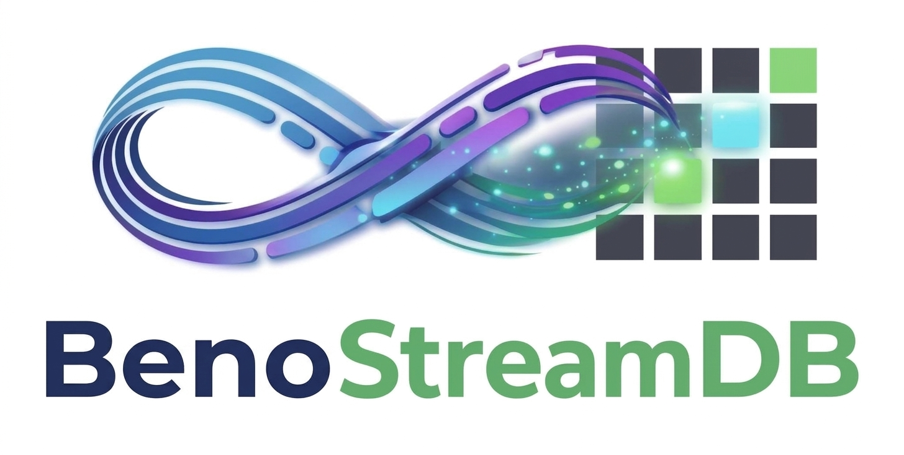

<p align="center">
  
</p>

# BenoStreamDB
**Serverless Index-Streaming Database with Overlay Indexing**

> ⚠️ **Developer Preview (v0.13.1)**
> BenoStreamDB is an early-stage database engine intended for evaluation, benchmarking, and community feedback. 
> - **API & Storage Mutability:** APIs, configuration schemas, and secondary index sidecar on-disk layouts may evolve between preview releases.
> - **Workload Suitability:** Not yet recommended for irreplaceable production data or mission-critical workloads requiring enterprise high-availability SLAs. Always back up authoritative data and pin versions.
> - **Integrity Invariant:** Operations will not silently corrupt state or lose acknowledged writes. If an advisory index sidecar is missing or damaged, queries gracefully fall back to direct Parquet scans while the overlay rebuilds.

### 📋 Feature Classification & Preview Scope

| Tier | Capabilities | Status |
| :--- | :--- | :--- |
| **Preview-Ready** | Embedded Python & Rust engine, Apache Iceberg (V2/V3) Parquet read/write, HNSW (Float32) vector search, in-process CSR graph analytics (PageRank, shortest path), DuckDB/DataFusion SQL compatibility, Puffin sidecar management | ✅ Fully supported & tested for evaluation |
| **Experimental** | 8-bit TurboQuant (TQ8), OpenSearch 7.10 & Qdrant REST gateway compatibility, Arrow Flight SQL server | ⚠️ Functional; APIs and performance tuning are actively evolving |

> **Serverless by default.** BenoStreamDB runs directly against object storage and does not require a database server or always-on cluster. For applications that prefer a network-accessible database endpoint, BenoStreamDB also provides an optional Arrow Flight SQL server interface.
>
> **Flight SQL currently provides single-process server access. Distributed/clustered execution is not implied by Flight support.**

An **index-overlay engine for the lakehouse**. BenoStreamDB layers reconstructible, persistent secondary indexes — scalar bitmaps, BM25 Okapi full-text, HNSW/IVF vector search, and CSR graph indexes — onto Parquet data that already lives in object storage, and exposes all of it through standard SQL (DataFusion) with pgvector-compatible syntax.

### Deployment Modes

1. **Embedded (Core)**:
   ```
   Application (Python / Rust / JVM) ──► BenoStreamDB Engine ──► Object Storage (S3/GCS/Azure/Local)
   ```
   Direct in-process database engine. Zero operational overhead, serverless-native, scales to zero.

2. **Server Mode (Optional Arrow Flight SQL)**:
   ```
   Remote Clients ──► Arrow Flight SQL (gRPC) ──► BenoStreamDB (Single Process) ──► Object Storage
   ```
   Standard, high-performance network database access for polyglot clients and BI tools.

3. **Distributed / Clustered**:
   *Status: Future / Experimental (Not currently supported).* Distributed coordinator and multi-node write/compaction scheduling are under design.

> ## 🔒 Security & Warehouse Catalog Policy
>
> **1. Stateless Authentication & RBAC**:
> Both `benostreamdb-flight` and `bsdb-search` support stateless authentication via static API keys (`BSDB_API_KEY`) and JWTs (HS256/RS256). JWT payloads are parsed to extract user roles (`"roles"` array) for native RBAC enforcement within the engine.
>
> **2. Authoritative Warehouse Catalog Policy (`.benostream-policy.json`)**:
> Warehouse read/write permissions are durably stored on storage root (`s3://bucket/warehouse/.benostream-policy.json`) and managed directly from the core database product:
> ```python
> import benostreamdb as bsdb
> session = bsdb.connect("s3://bucket/warehouse")
>
> # Query remote policy on the bucket
> policy = session.catalog_policy()
>
> # Grant or revoke read/write access per schema
> session.set_schema_access("analytics", read_only=False)
>
> # Lock down warehouse to read-only
> session.lock_all_read_only()
> ```
>
> **3. Read-Only vs. Immutable Policies**:
> - **Read-Only (`readonly`)**: Operational access state. Administrator/trusted pipelines can toggle a schema to read-write for scheduled ETL/backfills, then lock it back down.
> - **Immutable (`immutable`)**: Permanent write-once/WORM integrity constraint. Applied to system schemas (`default`, `public`, `sys`, `information_schema`) and compliance archives. Mutations are permanently rejected engine-wide and cannot be overridden by administrators.
>
> **4. Trusted vs. Untrusted Connector Boundary**:
> - **Trusted Data Engines** (Core DB, Flight SQL, Spark, Trino, dbt): Retain full access authorized by warehouse credentials.
> - **Untrusted Gateways** (MCP Agents, Search Gateway): If `.benostream-policy.json` is missing or unspecified, untrusted connectors are conservatively quarantined into **read-only mode across all tables**, restricting writes solely to transient `scratch.*` workspace tables.
> 
> *Note on TLS:* The network servers do not terminate TLS natively within the Rust binaries. When deploying over untrusted networks or the public internet, you must deploy BenoStreamDB behind a reverse proxy (like NGINX, Envoy, or an AWS ALB) that terminates TLS. See [SECURITY.md](SECURITY.md) for the full posture.


It is not a storage engine you have to migrate into. You can either write through it, or point it at an **existing Apache Iceberg table it does not own** and build indexes over that data in place. The authoritative Parquet files and the advisory index overlays are stored separately, so indexing never rewrites or duplicates your data.

## 🎯 Architecture: The Indexed Lakehouse

BenoStreamDB implements an indexed, compute-disaggregated lakehouse architecture that pairs authoritative open table storage with advisory, persistent secondary indexes and a unified retrieval layer. The indexes are **overlays**: they attach to data files as sidecar artifacts and can be layered onto tables BenoStreamDB did not create (see [Operating Modes](#-operating-modes-authoritative-vs-external-iceberg-tables) below).

```text
               Iceberg Table
                     │
       ┌─────────────┴──────────────┐
       │                            │
Authoritative Storage        Advisory Index Overlay
       │                            │
  Parquet Files              Scalar Bitmap / BM25 / HNSW / IVF / TQ / CSR Graph
```

> ### Core Architecture Invariants
> 1. **The Overlay Invariant**: Index files are derived, reconstructible state. They may be absent, stale, or deleted without compromising snapshot correctness. Queries may degrade to Parquet scanning or background recovery, but never return incorrect results.
> 2. **Publication Invariant**: A published manifest may reference only immutable artifacts that have already been successfully uploaded and verified to storage.
> 3. **Durability Invariant**: WAL truncation is permitted only after the corresponding data is durably represented by a committed manifest snapshot.
> 4. **Maintenance Invariant**: Maintenance operations may delete an artifact only if it is neither referenced by any active snapshot nor currently in-flight.
> 5. **Resource Invariant**: Index builds are gated to a memory-scaled concurrency budget, and production paths follow a no-panic policy — malformed input degrades to an error, never a crash.

BenoStreamDB sits between two categories of system that do not overlap. Vector/graph databases own your data and cannot do general SQL analytics over a lakehouse; lakehouse query engines do SQL over Iceberg/Parquet but have no native vector, full-text, or graph indexing. BenoStreamDB fills that seam:

| Capability | Vector/Graph DBs (Pinecone, Qdrant, Neo4j) | Lakehouse Engines (Trino, Spark, DuckDB) | BenoStreamDB |
|------------|--------------------------------------------|------------------------------------------|--------------|
| **Data ownership** | Must ingest/duplicate your data | Queries data in place | Queries data in place |
| **Vector search** | ✅ Native | ❌ Bolt-on | ✅ Native overlay index |
| **Full-text (BM25)** | Partial | ❌ Bolt-on | ✅ Native overlay index |
| **Scalar indexes** | Partial | ❌ Bolt-on | ✅ RoaringBitmap |
| **Graph analytics** | ✅ (separate system) | ❌ | ✅ SQL UDFs on edge tables |
| **SQL analytics** | ❌ | ✅ | ✅ DataFusion |
| **pgvector syntax** | ❌ | ❌ | ✅ |
| **Indexes on existing Iceberg tables** | ❌ | ❌ | ✅ Layered Indexing |
| **Embedding provenance & dimension guard** | ❌ | ❌ | ✅ Core-enforced table properties |
| **Deployment** | Managed cluster | Cluster | Embedded library / scale-to-zero |

> **Supported platforms, cargo feature gates, the trusted/untrusted boundary, and
> known limitations** are enumerated in [`docs/SUPPORT_MATRIX.md`](docs/SUPPORT_MATRIX.md).

## ⚡ Iceberg V2/V3 Compatibility

BenoStreamDB implements the core Apache Iceberg table format V2 and V3 features required for its indexed-lakehouse model:

| Feature | V1 | V2 | V3 | BenoStreamDB |
|---------|----|----|----|--------------| 
| **Sort Orders** | ❌ | ✅ | ✅ | ✅ Implemented |
| **Partition Evolution** | ❌ | ✅ | ✅ | ✅ Implemented |
| **Statistics (NDV)** | ❌ | ✅ | ✅ | ✅ Parquet `distinct_count` |
| **Row Lineage** | ❌ | ❌ | ✅ | ✅ `_row_id` (monotonic long), `_last_updated_sequence_number`, `next-row-id`, `first-row-id` |
| **Default Values** | ❌ | ❌ | ✅ | ✅ `initial-default` & `write-default` |
| **Deletion Vectors** | ❌ | ❌ | ✅ | ✅ Puffin Format Integrated |
| **Delete Files** | ❌ | ✅ | ✅ | ✅ Position + Equality Deletes |
| **Nanosecond Timestamps** | ❌ | ❌ | ✅ | ✅ `timestamp(ns)` & `time64(ns)` |

### New APIs

```python
import benostreamdb as bsdb

# Create table with sort order (V2)
table = bsdb.Table("s3://bucket/table")
table.replace_sort_order(["timestamp", "user_id"], ascending=[False, True])

# V3 tables emit row lineage: _row_id (monotonic long) and
# _last_updated_sequence_number, with next-row-id / first-row-id tracked
# in table metadata. Enable with table.format_version = 3.
table.format_version = 3
```

### Migration Guide: V2 → V3

Upgrading to V3 enables row-level operations and enhanced tracking:

1. **Enable**: set `table.format_version = 3` (persisted on the next commit)
2. **No Data Rewrite**: Existing data remains compatible
3. **Row lineage**: new rows get a monotonic `_row_id` (long) and `_last_updated_sequence_number`; each data file records its `first-row-id` and table metadata tracks `next-row-id`

## 🔄 Operating Modes: Authoritative vs. External Iceberg Tables

BenoStreamDB runs in two distinct modes depending on who owns the lakehouse storage:

| Mode | Who Owns the Parquet Data? | Who Runs Writes & Compaction? | Upstream IAM Required | Where Indexes Live |
| :--- | :--- | :--- | :--- | :--- |
| **Authoritative Mode** | BenoStreamDB | BenoStreamDB (`insert`, `compact`) | Read + Write | Inside the table storage prefix |
| **Detached Overlay Mode** | External (Spark, Flink, Databricks) | External engine | **Read-Only** (`s3:GetObject`) | Separate writable overlay bucket |

---

### Working with Tables: Authoritative Mode (Full Read / Write)

In Authoritative Mode, BenoStreamDB acts as the primary lakehouse database. It owns the table lifecycle: writing Parquet data files, committing ACID metadata snapshots, logging streaming writes to the WAL, and running background compaction.

```text
┌───────────────────────────────────────────────────────────┐
│              BenoStreamDB Table Storage Prefix             │
│                      (Read + Write)                       │
├───────────────────────────────────────────────────────────┤
│ • metadata/v1.metadata.json, snap-*.avro, *-m0.avro       │
│ • data/00001.parquet + data/00001.bsdb_idx (HNSW / BM25)  │
│ • _wal/ (Write-Ahead Log for streaming durability)        │
│ • _staging/ (Buffered memory chunks before commit)        │
└───────────────────────────────────────────────────────────┘
```

#### Step 1: Create or Open an Authoritative Table
```python
import pyarrow as pa
import benostreamdb as bsdb

schema = pa.schema([
    ("id", pa.int64()),
    ("title", pa.string()),
    ("embedding", pa.list_(pa.float32(), 128)),
    ("status", pa.string()),
])

# Create a new table in object storage
table = bsdb.Table.create("s3://my-warehouse/tables/articles", schema)

# Or open an existing table
table = bsdb.open_table("s3://my-warehouse/tables/articles")
```

#### Step 2: Declare Primary Key & Secondary Indexes
```python
# Declare primary key for uniqueness validation and O(1) point lookups
table.set_primary_key(["id"])

# Declare vector ANN index (TurboQuant 8-bit quantized or full Float32)
table.add_index("embedding", "hnsw_tq8")

# Declare full-text BM25 Okapi inverted index
table.add_index("title", "bm25")

# Declare scalar Roaring Bitmap index
table.add_index("status", "bitmap")
```

#### Step 3: Insert & Ingest Data
```python
# Batch or streaming insert (buffered in RAM/WAL, committed to Iceberg)
table.insert(arrow_batch)
table.commit()

# Or bulk cluster-free ingestion from existing Parquet files
table.ingest(["s3://my-warehouse/raw/part-0001.parquet"])
```

#### Step 4: Maintenance & Compaction
```python
# Merge small Parquet files into target file sizes (default 128MB)
table.compact()

# Prune unreferenced snapshots and orphan files
table.vacuum(retention_versions=24)
```

---

### Working with External Iceberg Tables: Detached Overlay Mode (Read-Only)

If your data already lives in an Apache Iceberg table created by Spark, Flink, Trino, Snowflake, or Databricks, **you do not need to migrate or copy that data**. BenoStreamDB attaches to it in read-only mode, extracts the schema, and builds rebuildable secondary index overlays in a separate, isolated storage prefix.

```text
┌─────────────────────────────────────────┐          ┌─────────────────────────────────────────┐
│     Upstream Customer Lakehouse         │          │     BenoStreamDB Overlay Prefix         │
│         (Strictly Read-Only)            │          │         (Writable Sidecars)             │
├─────────────────────────────────────────┤          ├─────────────────────────────────────────┤
│ • metadata/v1.metadata.json             │          │ • detached_catalog.json (lineage/sync)  │
│ • data/00001.parquet                    │◀─────────┤ • manifest.json (PK & index definitions)│
│ • data/00002.parquet                    │          │ • data/00001.bsdb_idx (HNSW / BM25)     │
│ (Managed & compacted by upstream Spark) │          │ • data/00002.bsdb_idx (HNSW / BM25)     │
└─────────────────────────────────────────┘          └─────────────────────────────────────────┘
```

#### Step 1: Mount the External Table
Call `Table.mount_external_iceberg()`. Provide the upstream table URI (where the customer's Iceberg metadata and Parquet files live) and your separate overlay storage URI (where BenoStreamDB writes its index sidecars):

```python
import benostreamdb as bsdb

# Mount external Iceberg table in read-only mode
table = bsdb.Table.mount_external_iceberg(
    table_uri="s3://customer-lakehouse/warehouse/events/",      # Upstream (Read-Only)
    overlay_storage_uri="s3://my-managed-indexes/events/"       # Overlay Bucket (Writable)
)
```
* **Storage Invariant**: BenoStreamDB creates an object store client with read-only access to `table_uri`. It physically cannot rewrite, delete, or alter the customer's Parquet files.

#### Step 2: Declare the Primary Key (`table.set_primary_key`)
External Iceberg tables often lack explicit primary key constraints in their metadata. On a mounted table, you declare the business entity key:

```python
# Specify the primary key for entity lookups and search result mapping
table.set_primary_key(["event_id"])
```
* **Where is this stored?** It is saved in the **overlay manifest** (`s3://my-managed-indexes/events/manifest.json`), **never** touching the upstream Iceberg metadata.
* **Why specify a primary key?**
  1. **Direct Entity Mapping**: Vector search and BM25 index hits map directly back to the business ID (`event_id` or `uuid`) so queries return entity identifiers without extra Parquet lookups.
  2. **Sub-Millisecond Point Lookups**: Enables $O(1)$ point queries (`SELECT * FROM table WHERE event_id = '...'`) using the primary key index in the overlay to bypass full Parquet scans.

#### Step 3: Declare Secondary Indexes (`table.add_index`)
Specify which columns you want to accelerate:

```python
# Build vector ANN index (TurboQuant 8-bit quantized or full Float32)
table.add_index("embedding", "hnsw_tq8")

# Build full-text BM25 Okapi inverted index
table.add_index("document_text", "bm25")

# Build scalar Roaring Bitmap index
table.add_index("status", "bitmap")
```
* **Where are the indexes stored?** The engine reads the external Parquet files, computes the graphs/postings, and writes `.bsdb_idx` sidecars exclusively into `s3://my-managed-indexes/events/`. Zero bytes are added to the customer's bucket.

#### Step 4: Keep Indexes in Sync with Upstream Mutations & Compactions
When the upstream engine (Spark, Flink, or Databricks) writes new rows or runs table compaction (`rewriteDataFiles`):
1. **Zero-Cost Change Detection**: Iceberg commits a new `v{N+1}.metadata.json` file. BenoStreamDB's `DetachedOverlayCatalog` tails the root metadata pointer with a single lightweight HTTP `GET` (zero S3 `LIST` calls).
2. **Differential Indexing**: When an upstream snapshot advances, only newly added or newly compacted Parquet files are indexed. Surviving Parquet files keep their existing overlays.
3. **Automated Background Sync**:
   ```python
   # Start background poller (checks upstream snapshot log every 60s)
   table.start_detached_sync_worker(interval_seconds=60)

   # Or trigger an immediate sync on demand (e.g. from an S3 event or webhook)
   table.sync_detached_overlay()
   ```
4. **Correctness Invariant (Checksum Lineage)**: If a customer compacts data and a query runs before the new index is built, the engine verifies the `source_data_checksum`, safely skips stale index sidecars, and falls back to a direct Parquet scan. **Queries never return stale, duplicate, or corrupted rows.**

#### Step 5: Querying
Query the mounted table using standard SQL, vector search, or hybrid retrieval:

```python
# 1. Sub-millisecond Vector Search
results = table.vector_search("embedding", query_vector, k=10)

# 2. Unified DataFusion SQL (with pgvector syntax and hybrid filters)
df = table.sql("""
    SELECT event_id, document_text, embedding <-> [0.1, 0.2, 0.3] AS distance
    FROM events
    WHERE status = 'active'
    ORDER BY distance ASC
    LIMIT 10
""")
```

#### Step 6: Declare Embedding Provenance (Core Guard)

Tables can declare which model produced their vectors. BenoStreamDB stores this as Iceberg table
properties and enforces it in the engine — not only in the MCP server:

```python
# Declare the model. The engine derives the dimension from its known-model
# catalogue, and a FixedSizeList vector column also carries it in the schema.
table.set_properties({
    "benostream.embedding.model": "BAAI/bge-small-en-v1.5",
})

# Mirrored into metadata/vN.metadata.json, so Spark, Trino, and PyIceberg see it too.
print(table.properties()["benostream.embedding.model"])
```

When vectors come from an HTTP service, record the provider and endpoint too. Credentials are
deliberately not stored in table metadata; the MCP server reads the key from
`BSDB_EMBEDDING_API_KEY`:

```python
table.set_properties({
    "benostream.embedding.model": "text-embedding-3-small",
    "benostream.embedding.dim": "1536",
    "benostream.embedding.provider": "http",
    "benostream.embedding.endpoint": "https://api.openai.com/v1/embeddings",
    "benostream.embedding.query_prefix": "",
})
```

The contract is per table: one model, one dimension, one vector space. Different tables can use
different providers without conflict. Within a table, `provider` and `endpoint` may change while the
model and dimension stay the same; the engine treats model + dimension as the vector space, so
endpoint failover is allowed but a model change is not. If you need multiple models, use one table
per embedding space (or carry a `model_id` column for application-level provenance and query the
tables separately). Vectors from different models should not share an index even when their
dimensions match. A single MCP process has one active embedding configuration; run separate MCP
instances for simultaneous providers, or compute vectors in the application and pass them in.

Credentials are supplied by the runtime, never by the table: `benostream.embedding.*` stores only the
contract. Run one MCP process per provider with its own `BSDB_EMBEDDING_API_KEY`, or put a
credential-multiplexing gateway in front and give MCP a single endpoint/key. Prefer the environment
variable over a literal `embedding.api_key` in JSON.

- Writes through Python, SQL/Flight SQL, MCP, and bulk ingest reject vectors whose length differs from
  the declared dimension. The dimension comes from `benostream.embedding.dim` when present, otherwise
  from the engine's known-model catalogue (BGE, E5, Nomic, OpenAI, ...) or a `FixedSizeList` column.
- Set `benostream.embedding.dim` explicitly only for a custom/unknown model, or for MRL truncation
  (e.g. `BAAI/bge-large-en-v1.5` truncated to 512).
- Changing or removing the declared model (or a declared dimension) on a non-empty table is rejected at
  the commit point, including the Iceberg REST `set-properties` action used by Spark/Trino. Re-ingest
  into a new table to change models.
- Legacy tables without provenance may adopt it once; after that the declared space is immutable.
- `FixedSizeList` columns are validated from the schema on every write. Set
  `BSDB_VALIDATE_EMBEDDINGS=strict` to also scan `List`/stringified vectors row by row.

Model identity cannot be inferred from a vector: the property is the contract. Writes that bypass both
the engine and the catalog (direct Parquet/object-store mutation) remain outside the guard.


## 🌐 REST APIs (OpenSearch & Qdrant)

BenoStreamDB includes an optional contrib HTTP search gateway (`contrib/benostreamdb-search`, crate `benostreamdb-search`) that exposes the core engine over standard REST protocols. By translating incoming requests into native BenoStreamDB columnar operations, it allows you to use existing tools without running traditional clustered databases.

- **OpenSearch / Elasticsearch 7.10 API (Port 9200)**: Drop-in compatibility for standard text indexing, bulk writes, and keyword search (e.g., connect Kibana or Grafana directly). See the [OpenSearch compatibility matrix](contrib/benostreamdb-search/docs/OPENSEARCH_COMPATIBILITY.md).
- **Qdrant Vector API (Port 6333)**: Qdrant v1.x REST emulation covering collections, points, payloads, vectors, aliases, and the universal query API. Qdrant's unstructured JSON payloads are dynamically inferred and converted into highly compressed Arrow columns on write. See the [Qdrant compatibility matrix](contrib/benostreamdb-search/docs/QDRANT_COMPATIBILITY.md) for the exact supported surface and known approximations.

Both APIs are hosted concurrently from a single binary, completely share the exact same underlying `AppState` and data files, and require zero data duplication. You can write a collection of embeddings via the Qdrant API and instantly query it via the OpenSearch API!

To start the dual-API server:
```bash
# Uses BSDB_SEARCH_PORT=9200 and BSDB_QDRANT_PORT=6333 by default
cargo run -p benostreamdb-search
```

## 🚀 Quick Start

### 🐳 Docker Quickstart (3 Minutes to First Query)

Run the full BenoStreamDB gateway stack with one command:

```bash
# Standalone All-in-One Container (Local storage)
docker run -d --name benostreamdb \
  -p 9200:9200 \
  -p 6333:6333 \
  -p 50051:50051 \
  benostreamdb/quickstart:latest

# Or Full-Stack Compose (RustFS S3 + Nessie Catalog + BenoStreamDB)
docker compose -f docker/docker-compose.quickstart.yml up -d
```

| Service | Protocol | Port | Description |
| :--- | :--- | :--- | :--- |
| **Elasticsearch 7.10** | REST / JSON | `9200` | Text indexing, BM25, and hybrid search |
| **Qdrant Vector** | REST / JSON | `6333` | Collections, point upsert/retrieve, payload & vector edits, vector search, aliases |
| **Arrow Flight SQL** | gRPC / Flight | `50051` | Zero-copy SQL for DuckDB, Polars, BI tools |

Verify cluster health:
```bash
curl http://localhost:9200/_cluster/health
```

#### GPU-Accelerated Docker (NVIDIA CUDA, AMD ROCm, Intel XPU)
Run with hardware acceleration across NVIDIA, AMD, or Intel GPUs:
```bash
# Launch with GPU override:
docker compose -f docker/docker-compose.quickstart.yml -f docker/docker-compose.gpu.yml up -d

# Verify compute engine reported by the Search API:
curl -s http://localhost:9200/
```
Output:
```json
{
  "name": "bsdb-search-1",
  "cluster_name": "bsdb-search",
  "version": { "number": "7.10.2", ... },
  "compute": {
    "backend": "cuda",
    "device_id": 0,
    "gpu_accelerated": true,
    "available": true
  },
  "tagline": "You know, you search"
}
```


### Python Installation

**Standard Install (CPU + WGPU/Vulkan):**
The default package includes automatic high-performance hardware detection for NVIDIA CUDA, Apple Metal, Intel Graphics/XPU, and AMD ROCm.

```bash
pip install benostreamdb
```

**Windows Users:**
BenoStreamDB is optimized for Linux/POSIX. Windows users should use **WSL2**.


### GPU Acceleration (Optional)

For GPU-accelerated vector operations, install the appropriate backend:

**NVIDIA CUDA:**
```bash
# Ubuntu/Debian
sudo apt-get install cuda-toolkit-12-3
# Verify: nvidia-smi
```

**AMD ROCm:**
ROCm support is now native on Linux via WGPU/Vulkan.
```bash
# Verify Vulkan support (standard in modern ROCm drivers)
vulkaninfo | grep vendor
# Verify: rocm-smi
```

**Apple Metal:**
- Included with macOS 12.3+ on Apple Silicon (M1, M2, M3, M4, M5)
- No additional installation required

**Intel XPU / Graphics:**
Intel Arc and Data Center GPUs are supported natively on Linux.
```bash
# Verify intel-media-va-driver or similar is present
clinfo | grep Intel
```

See [Python Vector API Documentation](docs/PYTHON_VECTOR_API.md) for detailed GPU setup instructions.

### pgvector SQL Compatibility

BenoStreamDB provides full pgvector-compatible SQL syntax for vector operations:

```sql
-- Use familiar pgvector operators
SELECT id, content, 
       embedding <-> '[0.1, 0.2, 0.3]'::vector AS l2_distance,
       embedding <=> '[0.1, 0.2, 0.3]'::vector AS cosine_distance
FROM documents
WHERE category = 'science'
ORDER BY l2_distance
LIMIT 10;

-- All six distance operators supported
-- <->  L2 (Euclidean)
-- <=>  Cosine  
-- <#>  Inner Product
-- <+>  L1 (Manhattan)
-- <~>  Hamming (direct on ::vector)
-- <%>  Jaccard (direct on ::vector)
```

> **💡 pgvector Compatibility Note on `<~>` (Hamming) & `<%>` (Jaccard):**  
> In BenoStreamDB, `<~>` and `<%>` operate directly on standard float `::vector` embeddings (evaluating binary indicator sets and quantized vectors) for developer convenience. In upstream PostgreSQL `pgvector`, these two operators are restricted exclusively to the `bit` data type.  
> 
> **PostgreSQL Conversion Equivalent:**
> ```sql
> -- BenoStreamDB:
> SELECT * FROM documents ORDER BY embedding <~> '[1, 0, 1]'::vector LIMIT 10;
> 
> -- PostgreSQL (pgvector 0.7.0+): requires binary_quantize() to produce bit types
> SELECT * FROM documents ORDER BY binary_quantize(embedding) <~> binary_quantize('[1, 0, 1]'::vector) LIMIT 10;
> ```

See [pgvector SQL Guide](docs/PGVECTOR_SQL_GUIDE.md) for complete documentation and conversion guide.

### Basic Usage

```python
import benostreamdb as bsdb

# Create table
table = bsdb.Table("s3://bucket/my-table")

# Write data (Pandas/PyArrow)
import pandas as pd
df = pd.DataFrame({
    "id": [1, 2, 3],
    "embedding": [[0.1, 0.2], [0.3, 0.4], [0.5, 0.6]]
})
table.write_pandas(df)
table.commit()

# Create high-performance vector index (TQ8 - 4x compression)
table.add_index("embedding", "hnsw_tq8")

# Query with filters (uses indexes!)
results = table.to_pandas(filter="id > 1")

# Vector search
query_vec = [0.15, 0.25]
results = table.to_pandas(
    vector_filter={"column": "embedding", "query": query_vec, "k": 10}
)

# Hybrid query (scalar + vector)
results = table.to_pandas(
    filter="category = 'science'",
    vector_filter={"column": "embedding", "query": query_vec, "k": 10}
)
```

## 🔄 Fluent Query API

BenoStreamDB features a fluent query API in Rust with method chaining. Python uses the `to_pandas()` API with filter and vector_filter arguments.

### Rust Fluent API

The same fluent interface is available in native Rust:

```rust
use benostreamdb::{Table, VectorValue};

#[tokio::main]
async fn main() -> anyhow::Result<()> {
    let table = Table::new("s3://bucket/my-table".to_string())?;
    let query_vec = vec![0.1f32, 0.2, 0.3];

    // Method chaining
    let results = table
        .query()
        .filter("age > 25")
        .vector_search("embedding", VectorValue::Float32(query_vec), 10)
        .select(vec!["name".to_string(), "score".to_string()])
        .to_batches()
        .await?;
    
    println!("Found {} result batches", results.len());
    Ok(())
}
```

### Benefits

- **Method Chaining**: Intuitive, readable query construction  
- **Type Safe**: Compile-time validation in Rust, runtime validation in Python
- **Performance**: Same underlying optimized execution as traditional APIs
- **Interoperable**: Mix with SQL queries and traditional `to_pandas()` calls
- **GPU Acceleration**: Automatic GPU context propagation for vector operations
- **TurboQuant Optimized**: Seamless integration with 8-bit/4-bit quantization

### TurboQuant Quantization (TQ8 / TQ4)

BenoStreamDB features **TurboQuant**, an optimized quantization engine that reduces vector storage costs while maintaining high search accuracy:

- **TQ8 (8-bit)**: 4x compression vs. float32. Near-lossless accuracy (typically >99% recall retention). Ideal for general-purpose RAG.
- **TQ4 (4-bit)**: 8x compression vs. float32. Maximum efficiency for massive datasets where storage cost is the primary bottleneck.

```python
# High-performance community default (HNSW-TQ8)
table.add_index("embedding", "hnsw_tq8")

# High-compression mode
table.add_index("embedding", "hnsw_tq4")

# Custom HNSW-PQ configuration
table.add_index("embedding", {
    "type": "hnsw_pq",
    "complexity": 32,
    "quality": 300,
    "compression": 32 # PQ subspaces
})
```

### Python Vector Distance API with GPU Acceleration

BenoStreamDB provides a comprehensive Python API for vector distance computations with GPU acceleration:

```python
import benostreamdb as bsdb
import numpy as np

# GPU-accelerated batch distance computation
# `ComputeContext` is an alias for `Device` (`GPUContext` also works).
ctx = bsdb.ComputeContext.auto_detect()  # Auto-detect CUDA/ROCm/Metal/XPU
print(f"Using GPU backend: {ctx.backend}")

# Create query and database vectors
query = np.random.randn(768).astype(np.float32)
database = np.random.randn(100000, 768).astype(np.float32)

# Compute distances on GPU (10x+ faster for large databases)
distances = bsdb.l2_batch(query, database, device=ctx)

# Find top-k nearest neighbors
k = 10
top_k_indices = np.argsort(distances)[:k]

# Single-pair distance computation
vec1 = np.array([1.0, 2.0, 3.0])
vec2 = np.array([4.0, 5.0, 6.0])
distance = bsdb.cosine(vec1, vec2)

# Sparse vector support for high-dimensional sparse data
sparse1 = bsdb.SparseVector(
    indices=np.array([0, 5, 100], dtype=np.int32),
    values=np.array([1.0, 2.5, 0.8], dtype=np.float32),
    dim=1000
)
sparse2 = bsdb.SparseVector(
    indices=np.array([5, 50, 100], dtype=np.int32),
    values=np.array([2.0, 1.5, 0.9], dtype=np.float32),
    dim=1000
)
distance = bsdb.l2_sparse(sparse1, sparse2)

# Binary vector operations (bit-packed for efficiency)
binary1 = np.packbits(np.random.randint(0, 2, 128))
binary2 = np.packbits(np.random.randint(0, 2, 128))
distance = bsdb.hamming_packed(binary1, binary2)
```

**Supported GPU Backends:**
- **CUDA** - NVIDIA GPUs (Linux, Windows via WSL2)
- **ROCm** - AMD GPUs (Native Linux via WGPU)
- **Intel XPU** - Intel Graphics (Native Linux via WGPU)
- **Metal (MPS)** - Apple Silicon (macOS)
- **Torch Alignment** - Automatically aliases `cuda` to `rocm` on AMD hardware if `torch.version.hip` is detected.
- **CPU** - Fallback for all platforms

**Supported Distance Metrics:**
- L2 (Euclidean), Cosine, Inner Product, L1 (Manhattan), Hamming, Jaccard

See [Python Vector API Documentation](docs/PYTHON_VECTOR_API.md) for complete API reference and GPU installation instructions

### SQL queries (full DataFusion support with pgvector syntax)

```python
import benostreamdb as bsdb
session = bsdb.Session()
session.register("users", table)

# Optional: Enable GPU acceleration for SQL queries
device = bsdb.Device.auto_detect()
device.activate()

# Simple SQL (via table — registers as table 't')
results = table.execute_sql("SELECT * FROM t WHERE id > 100")

# Vector similarity search with pgvector operators (GPU-accelerated)
results = session.sql("""
    SELECT id, content,
           embedding <-> '[0.1, 0.2, 0.3]'::vector AS distance
    FROM documents
    WHERE category = 'science'
    ORDER BY distance
    LIMIT 10
""")

# Joins (uses Index Nested Loop Join optimization)
results = session.sql("""
    SELECT u.name, o.amount
    FROM users u
    JOIN orders o ON u.id = o.user_id
    WHERE u.category = 'premium'
""")

# Maintenance
table.compact()
```

## 📊 Performance

We maintain reproducible benchmark suites under [`benchmarks/`](benchmarks/): an
ANN-Benchmarks competitor matrix (FAISS, hnswlib, pgvector, LanceDB, OpenSearch,
Neo4j+GDS, DuckDB, cuGraph), BEIR lexical/hybrid search, ClickBench SQL OLAP,
graph analytics, and production workload/concurrency/recovery drills. They roll
up into
[`benchmarks/results/BENCHMARK_REPORT.md`](benchmarks/results/BENCHMARK_REPORT.md),
and [`docs/BENCHMARKING.md`](docs/BENCHMARKING.md) gives the commands to
reproduce every number. Treat any figure that is not in one of those files as
unverified.

## 🏗️ Architecture

### Overlay Indexing

BenoStreamDB stores indexes as **sidecar files** alongside Parquet data:

```
s3://bucket/table/
├── data/
│   ├── segment_001.parquet                   # Main Data (Parquet)
│   ├── segment_001.id.inv.parquet           # Scalar index (Inverted Parquet)
│   ├── segment_001.emb.centroids.parquet    # Vector index centroids
│   └── segment_001.emb.cluster_0.hnsw.graph # Vector index graph (HNSW)
├── _manifest/
│   ├── v1.avro                              # Manifest (Iceberg/Avro)
│   └── v2.avro
└── _metadata/
    └── v1.metadata.json
```

### Manifest Format

**Apache Iceberg V2/V3 compliant** (Avro encoding):

```json
{
  "version": 2,
  "timestamp_ms": 1705512000000,
  "entries": [
    {
      "file_path": "segment_001.parquet",
      "file_size_bytes": 104857600,
      "record_count": 1000000,
      "index_files": [
        {
          "file_path": "segment_001.id.inv.parquet",
          "index_type": "scalar",
          "column_name": "id"
        },
        {
          "file_path": "segment_001.embedding.cluster_0.hnsw.graph",
          "index_type": "vector",
          "column_name": "embedding"
        }
      ]
    }
  ],
  "prev_version": 1
}
```

### Layered Indexing (Existing Iceberg Tables)

Because indexes are overlays, BenoStreamDB can index data it does not own. `Table.register_external` points at an existing Iceberg table's metadata, maps its schema, imports the current snapshot, and builds index overlays over the referenced Parquet files — without rewriting, copying, or taking ownership of the data.

```python
import benostreamdb as bsdb

# Attach to an existing Iceberg table and index it in place.
# The first argument is where the overlay indexes are stored; the second is
# the existing table's Iceberg metadata.
table = bsdb.Table.register_external(
    "s3://my-index-bucket/overlays/events",
    "s3://my-lake/warehouse/db/events/metadata/v1.metadata.json",
)

# Build overlays over the existing data
table.add_index("embedding", "hnsw_tq8")
table.add_index("body", "bm25")
```

The authoritative Parquet files stay where they are. The overlays are derived, reconstructible state: if they are lost or stale, queries degrade to Parquet scanning and the indexes can be rebuilt (see the Overlay Invariant above).

### Index Preload (Warm Start)

Indexes are served through bounded caches, so the first query after a cold
start pays the object-store fetch + decode cost. `Table.preload_indexes()`
pays it up front — the Dgraph-style "in-memory posting list" residency, but on
demand and bounded:

```python
# Warm HNSW/IVF, inverted/BM25, CSR graph, and metadata caches at startup.
stats = table.preload_indexes(max_memory_bytes=8 * 1024**3)
# {'indexes_seen': 42, 'indexes_warmed': 42, 'bytes_in_memory': 6_100_000_000,
#  'bytes_on_disk': 0, 'elapsed_ms': 1840, ...}
```

Indexes are warmed into RAM until `max_memory_bytes` is exhausted; the
remainder **spills into the mmap disk cache** (`BSDB_DISK_CACHE_DIR`,
`MADV_RANDOM`) for out-of-core serving. The bounded caches evict by
LRU/TinyLFU + TTI, so overflow evicts the least-recently-used entries. The
`benostream-search` gateway calls this on open, controlled by
`BSDB_SEARCH_PRELOAD` (default on) and `BSDB_SEARCH_PRELOAD_GB` (default 4 GiB).

## 🔌 Connectors

> [!NOTE]
> **MERGE INTO Support**
> BenoStreamDB implements `MERGE INTO` **natively in its SQL layer**. DataFusion's planner has no logical plan for `MERGE`, so the engine intercepts the parsed statement before planning and translates it into the key-based upsert (`Table::merge`, Merge-on-Read) and delete (`Table::delete_async`) primitives. Supported clauses:
>
> ```sql
> MERGE INTO target t USING source s ON t.id = s.id
> WHEN MATCHED AND t.flag THEN UPDATE SET name = s.name
> WHEN MATCHED THEN DELETE
> WHEN NOT MATCHED THEN INSERT (id, name) VALUES (s.id, s.name)
> WHEN NOT MATCHED THEN INSERT ROW
> WHEN NOT MATCHED BY SOURCE THEN DELETE;
> ```
>
> The `ON` condition must be an equi-join on the target's key column(s). Clauses are evaluated in order with first-match-wins semantics. The **Spark connector** additionally intercepts Spark's row-level `MERGE INTO` / `UPDATE` / `DELETE` operations (`BenoStreamMergeBuilder` → `BenoStreamRowLevelOperation`) and sends Iceberg position deletes plus appends through the JNI bridge. The **Trino connector** implements Trino's MERGE SPI (`beginMerge`/`finishMerge` + a `ConnectorMergeSink`) and a write path (`beginInsert` + `ConnectorPageSink`), so `INSERT` and `MERGE INTO` work through Trino as well.

### Spark
The Spark connector supports **Spark 3.5, 4.0, and 4.1** via a shared JNI FFI bridge. It intercepts row-level operations (like `MERGE INTO`) to take advantage of BenoStreamDB's fast indexing and supports configuring GPU backends.

```scala
// Read
val df = spark.read
  .format("benostream")
  .option("path", "s3://bucket/table")
  // Optionally configure the GPU device (cuda, mps, intel, rocm, auto, or cpu)
  .option("benostream.gpu_device", "cuda")
  .load()

// Write
df.write
  .format("benostream")
  .option("path", "s3://bucket/table")
  .save()
```

You can also globally configure the GPU for Spark stored procedures (e.g. index building):
```scala
spark.conf.set("spark.benostream.gpu.device", "cuda")
```

### Trino
The Trino connector is **read/write**. Reads push scalar and vector filtering down to the BenoStreamDB core via JNI, drastically reducing IO. Writes go through a `ConnectorPageSink` (Trino `Page` → Arrow → native append), `CREATE TABLE AS SELECT` creates the table then writes, and `MERGE INTO` is handled by Trino's MERGE SPI (`beginMerge`/`finishMerge` + a `ConnectorMergeSink`).

Configure the warehouse root and GPU backend in the catalog properties:

```properties
connector.name=benostreamdb
benostream.warehouse=s3://my-bucket/warehouse
benostream.gpu-device=cuda
```

Tables resolve to `{warehouse}/{schema}/{table}` (default warehouse `s3://default`).

```sql
-- Read (scalar/vector filter pushdown via JNI)
SELECT * FROM benostream.default.my_table
WHERE id > 100;

-- Write
INSERT INTO benostream.default.my_table VALUES (1, 'a');

-- CTAS
CREATE TABLE benostream.default.new_table AS
SELECT * FROM benostream.default.my_table;

-- MERGE (row-level, via the connector's merge sink)
MERGE INTO benostream.default.my_table t
USING benostream.default.staging s ON t.id = s.id
WHEN MATCHED THEN UPDATE SET name = s.name
WHEN NOT MATCHED THEN INSERT (id, name) VALUES (s.id, s.name);
```

You can configure the GPU backend for Trino globally or per-catalog using the properties file (e.g. `etc/catalog/benostream.properties`):
```properties
connector.name=benostreamdb
benostream.gpu-device=cuda
```

### Arrow Flight SQL Gateway
BenoStreamDB provides an optional high-performance Arrow Flight SQL server (`server/flight_sql`, crate `benostreamdb-flight`) running over gRPC (port 50051). This enables any JDBC, ODBC, ADBC, or Arrow-native client (including BI tools and distributed query engines) to query BenoStreamDB with zero-copy Arrow serialization and native index pushdown.

```bash
cargo run -p benostreamdb-flight
```

### dbt (`dbt-benostreamdb`)
Official dbt adapter for BenoStreamDB over Arrow Flight SQL. Provides native vector search macros and custom materializations:

- **Vector Macros**: `vector_distance(...)`, `knn_search(...)`, `vector_avg(...)`, `type_vector(...)`, `type_sparsevec(...)` with pgvector-compatible operators.
- **Custom Materializations**: Table and incremental materialization with support for `append`, `delete+insert`, and partition-looping `insert_overwrite`.
- **DDL Support**: Iceberg-compatible `PARTITIONED BY` syntax.

```bash
cd dbt-benostreamdb
pip install -e .
```

### Python (Direct & Network Clients)
```python
import benostreamdb as bsdb

# Embedded in-process execution (scales to zero)
df = bsdb.Table("s3://bucket/table").query().execute()
# Or using traditional API: df = bsdb.Table("s3://bucket/table").to_pandas()

# Network Arrow Flight SQL client (zero-copy gRPC streaming)
flight = bsdb.FlightClient("grpc://127.0.0.1:50051", token="secret")
df = flight.execute_pandas("SELECT * FROM market_data WHERE symbol = 'NVDA'")

# Network Search client (OpenSearch 7.10 / Qdrant REST gateway)
search = bsdb.SearchClient("http://127.0.0.1:9200")
results = search.hybrid_search(
    index="filings",
    text="revenue guidance semiconductor",
    vector=[0.12, -0.45, 0.88],
    top_k=10,
)
```

### MCP Server (AI Agent Tools)

Official **Model Context Protocol (MCP)** server (`contrib/benostreamdb-mcp`,
crate `benostreamdb-mcp`) that exposes BenoStreamDB to LLM agents (Claude
Desktop, Cursor, VS Code, Antigravity IDE) as JSON-RPC tools. It ships 12 tools —
including `execute_sql`, `hybrid_search`, `graph_rag_search`, `ingest_records`,
`list_embedding_models`, and persistent agent memory (`store_memory` /
`recall_memory`). It also runs local, no-LLM embeddings by default
(`BAAI/bge-small-en-v1.5`, 384-d), so ingestion and memory do not require an
external embedding API.

```bash
# Run instantly without local compilation
uvx benostreamdb-mcp --warehouse /path/to/warehouse
```

MCP is treated as an **untrusted connector**: if `.benostream-policy.json` is
absent, it is locked to read-only across persistent schemas (writes are limited
to `scratch.*`). See
[`contrib/benostreamdb-mcp/README.md`](contrib/benostreamdb-mcp/README.md) and
[`docs/integrations/MCP.md`](docs/integrations/MCP.md).

### Snowflake (Untested / Developer Preview)

> ⚠️ **Untested:** The Snowflake integration is in developer preview based on the open Iceberg REST and External Volume specifications. Live production certification is in progress.

BenoStreamDB can mount and index **Snowflake Iceberg Tables** residing on customer-managed External Volumes (Amazon S3, GCS, or Azure Blob) in Detached Overlay Mode with zero data duplication and zero Snowflake compute credits:

```python
import benostreamdb as bsdb

# Mount external Snowflake Iceberg table in read-only mode
table = bsdb.Table.mount_external_iceberg(
    table_uri="s3://customer-lakehouse/snowflake_warehouse/events/",
    overlay_storage_uri="s3://my-index-overlays/events/"
)
table.set_primary_key(["event_id"])
table.add_index("embedding", "hnsw_tq8")
table.add_index("transcript", "bm25")

# Keep synchronized when Snowflake commits new data
table.start_detached_sync_worker(interval_seconds=60)
```
See the [Snowflake Integration Guide](docs/integrations/SNOWFLAKE.md) for full configuration and External Volume walkthrough.

## 🔨 Building Connectors

The Spark and Trino connectors require building shaded "fat" JARs that bundle the native Rust core.

### Matrix Build
We provide a script to build a full matrix of connectors (Java 17/21, Spark 3.5/4.0):
```bash
./build-connectors.sh
```

### Hardware Acceleration
- **Standard**: Build with CPU + Intel Graphics/XPU support (default).
- **CUDA**: Build for NVIDIA GPUs:
  ```bash
  ./build-connectors.sh --cuda
  ```

### Portable Toolchain
The build script automatically downloads a project-local Maven and JDK 21 if they are missing from your system, ensuring a consistent build environment.

### Artifacts
Final JARs and ZIPs are collected in the `connector-artifacts/` directory.

## 🧪 Development

### Build & Test

```bash
# Build Rust library
cargo build --release

# Run tests
cargo test

# Run benchmarks
cargo bench

# Build Python bindings
maturin develop

# Python tests
pytest tests/
```

### Project Structure

```
benostreamdb/
├── src/
│   ├── lib.rs                  # Main library & PyO3 module registration
│   ├── core/
│   │   ├── table/              # Table API (read, write, schema, fluent query)
│   │   ├── reader/             # Index-aware Parquet reader
│   │   ├── manifest/           # Manifest management (Iceberg/Avro)
│   │   ├── index/              # HNSW, inverted, bitmap indexes
│   │   ├── catalog/            # REST, Nessie, Glue, Hive, Unity, JDBC catalogs
│   │   ├── sql/                # DataFusion integration & pgvector operators
│   │   ├── planner.rs          # Query planner & optimizer
│   │   ├── iceberg/            # Iceberg V2/V3 metadata & schema
│   │   ├── lock.rs             # Vendor-neutral distributed locking (FileBasedLock via object store CAS)
│   │   ├── compaction.rs       # Compaction engine
│   │   ├── maintenance.rs      # Vacuum/GC
│   │   ├── storage.rs          # Multi-cloud storage (S3, GCS, Azure, local)
│   │   ├── wal.rs              # Write-Ahead Log
│   │   ├── ffi.rs              # JNI bindings (Spark/Trino)
│   │   └── error.rs            # Structured error types
│   ├── telemetry/              # Structured tracing (OpenTelemetry) & Prometheus metrics
│   ├── python/                 # PyO3 bindings (table, graph, session, catalogs)
│   ├── python_distance.rs      # Vector distance API
│   └── python_gpu_context.rs   # GPU device management
├── benostream-gpu-ann/         # GPU-accelerated ANN kernels (CUDA, Metal, Vulkan)
├── server/
│   └── flight_sql/             # Arrow Flight SQL gRPC server (`benostreamdb-flight`)
├── contrib/
│   ├── benostreamdb-search/    # OpenSearch 7.10 & Qdrant REST gateway (`benostreamdb-search`)
│   └── benostreamdb-mcp/       # Model Context Protocol agent tool server (`benostreamdb-mcp`)
├── dbt-benostreamdb/           # Official dbt adapter (Arrow Flight SQL)
├── spark-benostreamdb/         # Apache Spark connector (Java, Spark 3.5 / 4.0 / 4.1)
├── trino-benostreamdb/         # Trino connector (Java SPI) + `etc/` configuration templates
├── tests/
│   ├── integration/            # Infrastructure integration tests
│   ├── benchmarks/             # Performance benchmarks
│   └── python/                 # Python binding tests
└── benchmarks/                 # Benchmarks
```

## 🔎 Search API (OpenSearch / Elasticsearch 7.10-compatible)

BenoStreamDB ships an optional contrib add-on, **`bsdb-search`** (`contrib/benostreamdb-search`, crate `benostreamdb-search`),
that serves an **OpenSearch 1.x / Elasticsearch 7.10**-compatible REST API on top of
the engine — plus a **Qdrant**-compatible API for vector workloads. It is built for
website search, document catalogs, and knowledge bases where a 50–200 ms query latency
envelope is acceptable and object-storage-native, scale-to-zero hosting is desired.

```bash
cargo build --release -p benostreamdb-search --bin bsdb-search
BSDB_SEARCH_BIND=127.0.0.1 BSDB_SEARCH_PORT=9200 ./target/release/bsdb-search

# Index + search (ES 7.10 wire format)
curl -X POST localhost:9200/articles/_doc -H 'content-type: application/json' \
     -d '{"title":"Hello","body":"Welcome to BenoStreamDB"}'
curl -X POST localhost:9200/articles/_refresh
curl -X POST localhost:9200/articles/_search -H 'content-type: application/json' \
     -d '{"query":{"match":{"body":"BenoStreamDB"}}}'
```

**Running as a Background Service**

For production deployments on Linux and macOS, you can easily install `benostream-search` as a native background daemon (`systemd` or `launchd`) so it runs continuously and starts on boot:

```bash
# Ensure the binary is built and available at /usr/local/bin/benostream-search
sudo benostreamdb install-service
```
This will automatically generate the configuration file and start the service. See [scripts/services/README.md](scripts/services/README.md) for full configuration and uninstallation details.

**Supported:** cluster/health/cat/stats, index CRUD, mapping GET/PUT, `_doc`, `_bulk`,
`_refresh`, `_search` (`match` BM25, `knn` HNSW, hybrid RRF, `filter`/`bool` with
`term`/`terms`/`range`/`exists`, `match_all`), `_count`, `_source` filtering,
`from`/`size`, and Prometheus `/metrics`.

**Not supported (v1):** ILM (index lifecycle), multi-node
sharding/replicas, and Kibana. (Stateless **authentication** — API key / JWT,
with admin-only writes — *is* supported; see the search-gateway Security
section.) See
[contrib/benostreamdb-search/docs/OPENSEARCH_COMPATIBILITY.md](contrib/benostreamdb-search/docs/OPENSEARCH_COMPATIBILITY.md) for the full matrix and
[docs/INSTALLATION.md](docs/INSTALLATION.md) for a complete quickstart.

## 📈 Roadmap

### ✅ Production Ready Foundations
- [x] **Core Storage & Concurrency**: Hybrid segment format (Parquet + indexes), Iceberg V2/V3 manifests, atomic `PendingWrite` WAL buffer, `maintenance_lock` barriers, OCC commits.
- [x] **Vector Search Overlays**: Zero-copy Arrow IPC HNSW & IVF-PQ, TurboQuant™ (TQ4/TQ8), SIMD intrinsics, GPU acceleration (`benostream-gpu-ann`: CUDA, Metal, Vulkan).
- [x] **Text & Scalar Overlays**: Inverted BM25 Okapi indexes, Roaring Bitmap scalar indexes, Composite multi-column filters, Statistics pruning.
- [x] **Embedding Provenance & Vector-Space Guard**: `benostream.embedding.*` Iceberg table properties, mirrored into `metadata/vN.metadata.json`; dimension checks in the engine write path and model/dimension immutability at the commit point across Python, SQL/Flight SQL, MCP, Spark, and Trino.
- [x] **Core Graph Engine**: Zero-copy Memory-Mapped CSR Graph Index (`MmapCsrGraph`), Core Graph Traversal operator (`Table::graph_neighborhood`), Graph SQL UDFs.
- [x] **Connectors & Gateways**: Apache Spark (`spark-benostreamdb`), Trino (`trino-benostreamdb`), dbt (`dbt-benostreamdb`), Arrow Flight SQL server (`server/flight_sql`), Contrib Search Gateway (`contrib/benostreamdb-search`), Contrib MCP server (`contrib/benostreamdb-mcp`).

### 📋 Active Roadmap Themes
- [x] **Reactive Lakehouse Streaming**: `Table::subscribe()` core API and predicate-filtered subscriptions are shipped. (Arrow Flight streaming subscriptions are deferred).
- [x] **Declarative Edge Tables & Graph Overlays**: `table_type = 'edge'` DDL and native DataFusion SQL graph walk functions (`graph_neighbors`, etc.) are shipped.
- [x] **JSON-Path Inverted Index**: Shipped.
- [ ] **Domain-Specific BM25 Analyzers**: Configurable table tokenizers (CamelCase code tokenizer, multilingual Snowball stemmers, CJK segmentation).
- [x] **AI Agent Tools & Client Ecosystem**: Dedicated Model Context Protocol (MCP) server (`contrib/benostreamdb-mcp`) shipped. LangChain/LlamaIndex vector store adapters remain.

*For the complete detailed roadmap and architecture status, see [docs/ROADMAP.md](docs/ROADMAP.md).*

## 🤝 Contributing

We welcome contributions! See [CONTRIBUTING.md](CONTRIBUTING.md) for guidelines.

## 📄 License

The crate is dual-licensed under **MIT AND Apache-2.0** (see [`Cargo.toml`](Cargo.toml)).

This project contains modified source code from various upstream open-source projects (including `hnsw_rs` for pre-filtering support), which were originally licensed under Apache 2.0. BenoStreamDB maintains compliance by retaining all original copyright notices and providing prominent notice of modifications in the relevant source files.

## 🙏 Acknowledgments

- **Apache Iceberg** - Inspiration for manifest design
- **Apache Arrow** - Columnar format
- **hnsw_rs** - Vector indexing
- **RoaringBitmap** - Scalar indexing

---

**Built with ❤️ in Rust**


