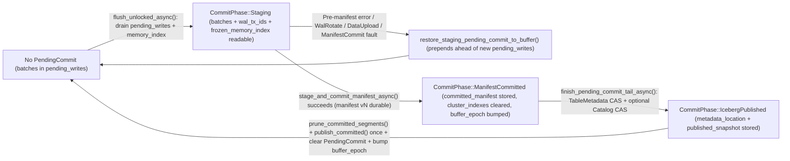

# ADR-008: `PendingCommit` Transaction State Machine, Linearizable Reads, and Segmented WAL Recovery

> **Status: implemented (`v0.15.2`, Audit `M2`).**
> Implemented across [`src/core/table/mod.rs`](https://github.com/benolabsai/benostreamdb/blob/main/src/core/table/mod.rs), [`write.rs`](https://github.com/benolabsai/benostreamdb/blob/main/src/core/table/write.rs), [`read.rs`](https://github.com/benolabsai/benostreamdb/blob/main/src/core/table/read.rs), [`stage.rs`](https://github.com/benolabsai/benostreamdb/blob/main/src/core/table/stage.rs), [`maintenance.rs`](https://github.com/benolabsai/benostreamdb/blob/main/src/core/table/maintenance.rs), [`builder.rs`](https://github.com/benolabsai/benostreamdb/blob/main/src/core/table/builder.rs), [`src/core/wal.rs`](https://github.com/benolabsai/benostreamdb/blob/main/src/core/wal.rs), [`src/core/metadata.rs`](https://github.com/benolabsai/benostreamdb/blob/main/src/core/metadata.rs), [`src/core/manifest/`](https://github.com/benolabsai/benostreamdb/blob/main/src/core/manifest/manager/commit.rs), and [`src/core/catalog/rest.rs`](https://github.com/benolabsai/benostreamdb/blob/main/src/core/catalog/rest.rs).
> Certified by [`tests/test_m2_commit_state_machine.rs`](https://github.com/benolabsai/benostreamdb/blob/main/tests/test_m2_commit_state_machine.rs) (Pillars 1–9), [`docs/PRODUCTION_READINESS_ASSESSMENT.md`](https://www.benostreamdb.org/guides/production_readiness.html), and [`docs/RECOVERY_RUNBOOK.md`](https://www.benostreamdb.org/guides/recovery_runbook.html).

---

## 1. Context & Operational Motivation

BenoStreamDB eliminates the three-system ingestion tax — separate OLTP buffer database, Kafka-to-Iceberg micro-batch ETL, and standalone vector index — by buffering writes in an embedded write-ahead log (WAL) and committing directly to Parquet segments and Apache Iceberg snapshots inside a single Rust process. When flush/commit execution is interleaved with concurrent readers, concurrent buffered writers, process crashes, or multi-writer object-store contention, implicit state transitions between in-memory buffers and durable Iceberg metadata introduce five concrete failure modes:

1. **Visibility Holes During Flush (`buffer`-to-`manifest` Handoff):** Draining `pending_writes` and `memory_index` before the Iceberg manifest becomes durable makes committed-in-WAL rows temporarily invisible to concurrent SQL scans and ANN searches. Conversely, retaining those batches in `pending_writes` after manifest commit causes duplicate row emission.
2. **Irrecoverable Pre-Manifest Flush Failures:** If Parquet staging, object-store multipart upload, or Iceberg V3 row-lineage OCC fails after `pending_writes` has been drained, discarding or dropping the drained batches breaks the read-your-own-writes and retry guarantees on subsequent `commit_async()` calls.
3. **WAL Truncation Races:** Deleting every `.arrow` file under `_wal/` after a snapshot commit can drop newly appended transactions from concurrent `write_async()` calls that arrived while the flush was uploading Parquet files. Conversely, a single torn trailing frame after `SIGKILL` or `SIGABRT` must not quarantine valid prefix records in the same WAL segment.
4. **Version Hint & Catalog Convergence Races:** Unconditional overwrites of `metadata/version-hint.text` or single-shot REST catalog commits (`POST /tables/...`) allow delayed writers to regress reader metadata pointers or abort on HTTP 409 conflicts even when the underlying Parquet and manifest state already converged.
5. **Orphaned Data Files on V3 OCC Conflicts:** Under Apache Iceberg Format Version 3, each writer assigns sequential `_row_id` and `_last_updated_sequence_number` values relative to the current manifest head. When two V3 writers race and one loses the manifest CAS, its staged Parquet files carry overlapping `_row_id` ranges and must be deleted before retrying against the new head.

Before `v0.15.2`, these boundaries were handled implicitly across separate helper methods in `write.rs`. Extended production-readiness audit **`M2`** replaced that implicit control flow with an explicit, inspectable state machine: [`PendingCommit`](https://github.com/benolabsai/benostreamdb/blob/main/src/core/table/mod.rs#L148-L163).

---

## 2. Decision: Explicit `PendingCommit` State Machine

All buffered table commits execute under `Table::commit_lock` and record their lifecycle phase inside `Table::pending_commit: Arc<parking_lot::Mutex<Option<PendingCommit>>>` alongside a monotonically incremented `buffer_epoch: Arc<AtomicU64>` (`Ordering::SeqCst`).



### 2.1 State Definitions & Lock Ordering

[`CommitPhase`](https://github.com/benolabsai/benostreamdb/blob/main/src/core/table/mod.rs#L128-L139) enforces strict phase ordering (`PartialOrd`, `Ord`):

| Phase | Authoritative Durability State | In-Memory Reader View | Failure / Retry Action |
|---|---|---|---|
| **`Staging`** | Batches are durable in `_wal/` (under `Sync`); Parquet/manifest commit has **not** succeeded. | Readers scan committed manifest **plus** `PendingCommit::batches` / `frozen_memory_index` **plus** newer `pending_writes`. | [`restore_staging_pending_commit_to_buffer`](https://github.com/benolabsai/benostreamdb/blob/main/src/core/table/write.rs#L1028-L1080) prepends staged batches and WAL TX IDs **ahead** of any newer arrivals in `pending_writes` and merges `frozen_memory_index` via `extend_from`. |
| **`ManifestCommitted`** | `_manifest/v{N}.json` is atomically committed (`PutMode::Create`), carrying `benostream.committed_wal_tx` CSV. Background index tasks are ready to spawn. | Readers load manifest `>= v{N}`, **ignore** `PendingCommit::batches`, and include only newer `pending_writes`. | Subsequent flush calls [`finish_pending_commit_tail_async`](https://github.com/benolabsai/benostreamdb/blob/main/src/core/table/write.rs#L1726-L1960), skipping staging and converging tail steps idempotently. |
| **`IcebergPublished`** | `metadata/v{K}.metadata.json` and any configured external catalog reflect `snapshot_id`. | Same as `ManifestCommitted`; external Iceberg engines (Spark, Trino, DuckDB) now observe the snapshot. | Finishes remaining WAL pruning (`prune_committed_segments`), notifies `Table::subscribe()` once via `subscribers_notified`, clears `pending_commit`, and bumps `buffer_epoch`. |

To eliminate lock-inversion deadlocks between concurrent writers, flush tasks, readers, and primary-key validators, every synchronous lock block across [`write.rs`](https://github.com/benolabsai/benostreamdb/blob/main/src/core/table/write.rs#L918-L923), [`read.rs`](https://github.com/benolabsai/benostreamdb/blob/main/src/core/table/read.rs#L658-L663), and [`truncate_async`](https://github.com/benolabsai/benostreamdb/blob/main/src/core/table/write.rs#L103-L115) strictly obeys the total acquisition order:

```text
pending_commit (Mutex)  -->  pending_writes (RwLock)  -->  indexing.memory_index (RwLock)
```

Asynchronous coarse-grained serialization sits outside these short critical sections:
- `maintenance_lock`: shared read guard for `write_with_durability_async` and `flush_async`; exclusive write guard for `compact`, `truncate_async`, and `vacuum`.
- `write_with_durability_async` explicitly drops its `_maintenance_guard` immediately after appending to WAL, `memory_index`, and `pending_writes`, preventing self-deadlock when autocommit or `BSDB_CACHE_GB` spillover triggers `commit_async()`.

---

## 3. Core Architectural Invariants & Mechanisms

### 3.1 Linearizable Reader Double-Check (`buffer_epoch`)

Without an atomic barrier spanning manifest loading and in-memory buffer inspection, a concurrent reader could read an older cached manifest (`v{N-1}`) just as a flush transitions `PendingCommit` from `Staging` to `ManifestCommitted`, missing the committed batch completely.

[`Table::read_expr_stream_async`](https://github.com/benolabsai/benostreamdb/blob/main/src/core/table/read.rs#L623-L712) prevents torn snapshots through a lock-free sequence-checked retry loop (`0..8usize`):

1. Load `epoch1 = self.buffer_epoch.load(Ordering::SeqCst)`.
2. Read the durable manifest snapshot (`manifest_manager.load_latest_full().await` on attempt 0; escalating to uncached `manifest_manager.load_latest_direct().await` when `force_direct = true`).
3. Acquire the synchronous triple `(pending_commit, pending_writes, memory_index)` in canonical order, extracting:
   - `committed_ver`: `pc.committed_manifest.version` if `pc.phase != CommitPhase::Staging`.
   - `staging`: `(pc.batches, pc.frozen_memory_index)` if `pc.phase == CommitPhase::Staging`.
   - `active`: current `(batches, memory_index)` from `pending_writes`.
4. Drop the synchronous locks and load `epoch2 = self.buffer_epoch.load(Ordering::SeqCst)`.
5. Check `stale_manifest = committed_ver.is_some_and(|cv| version < cv)`.
6. If `epoch2 != epoch1 || stale_manifest`, set `force_direct = true` and retry.

On transition from `Staging` to `ManifestCommitted`, the committer updates `committed_manifest`, clears cached table-level `cluster_indexes` and `vector_routers` (so ANN fast paths cannot serve pre-commit centroids/graphs over stale views), and calls `bump_buffer_epoch()`. Table-level cluster fast paths are likewise restricted to quiescent intervals where `staging_snap.is_none() && active_snap.0.is_empty()` (`read.rs:723`).

### 3.2 Segmented WAL Rotation, Watermark Pruning & Torn-EOF Tolerance

Instead of truncating the entire `_wal/` directory on commit, each open table writes Arrow IPC streams into per-instance, monotonically named segments (`log_{ts:020}_{pid:06}_{seq:08}.arrow`) tracked by `WalSegmentRegistry` (`active` vs `sealed` segments with associated `HashSet<Uuid>` transaction IDs):

1. **Per-Transaction Tagging:** Every `write_with_durability_async` assigns a fresh `tx_id: Uuid` and embeds `benostream:tx_id` / `benostream:seq` schema metadata onto each WAL batch (`tag_batch_with_wal_tx`). Under `WalDurability::Sync`, `sync_wal()` prefers `fdatasync` (`File::sync_data()`) and falls back to `fsync` (`File::sync_all()`), returning an error rather than a false acknowledgement if both fail.
2. **Pre-Commit Segment Rotation:** Before staging Parquet files, `flush_unlocked_async` calls [`wal.rotate_async()`](https://github.com/benolabsai/benostreamdb/blob/main/src/core/wal.rs#L948-L964). The WAL worker flushes pending acks, finishes the Arrow `StreamWriter`, calls `sync_data()`, moves the finished file into `reg.sealed`, and opens a new active file for concurrent writers arriving while S3/Parquet staging is in progress.
3. **Watermark Pruning:** After `ManifestCommitted` records `append_committed_wal_tx` in the manifest property `benostream.committed_wal_tx` (deduplicated and bounded to the trailing `MAX_TRACKED_WAL_TX = 256` entries in `commit.rs#L560-L584`), [`prune_committed_segments`](https://github.com/benolabsai/benostreamdb/blob/main/src/core/wal.rs#L619-L667) deletes a sealed segment **only if** `!entry.has_untagged && entry.txs.is_subset(&committed_set)`. Concurrent in-flight active files and any segment holding uncommitted transactions remain untouched on disk.
4. **Startup Idempotency & Torn-EOF Recovery:** On reopen ([`TableBuilder::build_async`](https://github.com/benolabsai/benostreamdb/blob/main/src/core/table/builder.rs#L401-L457)), [`open_wal_segment`](https://github.com/benolabsai/benostreamdb/blob/main/src/core/wal.rs#L99-L205) and [`SafeIpcSegmentIter`](https://github.com/benolabsai/benostreamdb/blob/main/src/core/wal.rs#L61-L97):
   - Gracefully skip segments that vanished concurrently before opening (`ErrorKind::NotFound`).
   - Treat 0-byte segments, zeroed preallocation headers (`<= 8` bytes), truncated Arrow IPC continuation prefixes (`< 4` bytes matching `0xFFFFFFFF`), 0-length schemas, and `UnexpectedEof` mid-schema as `OpenedWalSegment::Empty`.
   - Treat trailing `UnexpectedEof` inside an incomplete final batch frame as end-of-stream (`warn!`), preserving every prior synced complete batch in the segment.
   - Reject genuine mid-stream corruption (invalid non-zero magic bytes, invalid/oversized `meta_len > 64 MiB` or `< 0`, or non-EOF FlatBuffers corruption) with an error requiring operator intervention.
   - Skip already-committed `tx_id`s present in `benostream.committed_wal_tx` and register recovered segment TX sets via `register_recovered_segment` so the next commit prunes them cleanly.

### 3.3 Idempotent Staging, V3 Strict OCC & Metadata/Catalog Convergence

- **WAL-TX Idempotency Across Ambiguous Manifest Acks:** Inside [`stage_and_commit_manifest_async`](https://github.com/benolabsai/benostreamdb/blob/main/src/core/table/write.rs#L1237-L1724), before staging Parquet files, the committer inspects `benostream.committed_wal_tx` on the durable manifest head (`load_latest_direct()`). If all `wal_tx_ids` for the `Staging` commit are already recorded on the durable head (for instance, after an ambiguous S3 timeout where the commit actually succeeded), it updates the local version cache monotonically and converges without writing duplicate Parquet segments.
- **V3 Row-Lineage Strict OCC:** When `effective_fv >= 3`, `CommitMetadata` sets `expected_version: Some(head_ver)`. Because V3 Parquet segments embed immutable `_row_id` and `_last_updated_sequence_number` columns assigned from `head_ver`, a stale base version makes those staged segments invalid. On `BenoStreamError::ManifestVersionMismatch`, the committer calls `cleanup_staged_segment_files()` to delete the unusable Parquet files and retries up to `MAX_V3_RETRIES = 64` with `2–15 ms` randomized backoff (`write.rs:1698-1715`).
- **Monotonic Iceberg `TableMetadata` & `version-hint.text` CAS:** [`TableMetadata::commit_update_atomic`](https://github.com/benolabsai/benostreamdb/blob/main/src/core/metadata.rs#L466-L533) discovers `latest_version_in_store`, checks idempotency (`MetadataUpdateOutcome::AlreadyCurrent`), merges snapshots monotonically via `merge_snapshot_monotonic`, writes `metadata/v{N}.metadata.json` with `PutMode::Create` across up to 64 CAS attempts, and advances `metadata/version-hint.text` via [`advance_version_hint`](https://github.com/benolabsai/benostreamdb/blob/main/src/core/metadata.rs#L360-L431) using conditional `PutMode::Update(UpdateVersion { e_tag, version })` so delayed writers can never regress the hint file.
- **REST Catalog Conflict Retry:** [`commit_catalog_step_async`](https://github.com/benolabsai/benostreamdb/blob/main/src/core/table/maintenance.rs#L558-L687) submits optimistic Iceberg requirements (`assert-table-uuid`, `assert-ref-snapshot-id`) and retries HTTP 409 / `CommitFailedException` responses up to `MAX_CATALOG_RETRIES = 8`, reloading remote catalog state, checking if `snapshot_id` already landed, re-merging `TableMetadata` if the catalog location moved ahead, and sleeping `5 * (attempt + 1)` ms between retries.

### 3.4 Staged Distributed Connector Contract (`stage.rs`)

For distributed JVM connectors (Spark `BatchWrite` executors staging Parquet files while the driver commits metadata), [`src/core/table/stage.rs`](https://github.com/benolabsai/benostreamdb/blob/main/src/core/table/stage.rs) aligns with `M2` invariants without forcing multi-GB executor payloads through the driver:
- `Table::write_mode()` returns `"files"` for Iceberg Format Version 2 (allowing stateless parallel executor staging via `stage_data_files_async` + driver deduplicated `commit_staged_entries_async`) and `"buffered"` for Format Version 3 (routing through the WAL + `PendingCommit` V3 row-lineage OCC coordinator so concurrent tasks cannot emit overlapping `_row_id` ranges).
- `commit_staged_entries_async` acquires `maintenance_lock.read()` + `commit_lock`, calls `load_latest_direct()`, deduplicates already-committed paths on retry, and calls `ensure_table_metadata_async` + `publish_snapshot_async`.

---

## 4. Honest Architectural Scope & Boundaries

Consistent with BenoStreamDB's systems-first contract, operators must respect four explicit boundaries of `PendingCommit`:

1. **Single-Table Coordinator Only:** `PendingCommit`, `commit_lock`, and `maintenance_lock` coordinate within a single `Table` handle against shared object-store CAS (`_manifest/v{N}.json` and `metadata/v{N}.metadata.json`). Multi-table cross-statement transactions and distributed two-phase consensus protocols are **out of scope**.
2. **Remote Object Storage + Ephemeral Local WAL:** When opening an `s3://`, `gs://`, or `az://` URI without setting `BSDB_WAL_DIR` or `TableBuilder::with_wal_dir()`, the WAL defaults to local temporary storage (`/tmp/benostream_wal/...`) and logs a startup `tracing::warn!`. Un-committed WAL records in temporary local storage do not survive container or VM loss prior to `commit_async()`.
3. **256-Transaction Manifest Window:** `benostream.committed_wal_tx` retains the trailing `MAX_TRACKED_WAL_TX = 256` UUIDs in `_manifest/v{N}.json`. Segment rotation + `prune_committed_segments()` removes committed `.arrow` segments immediately during `finish_pending_commit_tail_async()`, preventing accumulation; however, if an operator restores a snapshot older than 256 commits alongside unpruned legacy WAL files, manual WAL cleanup may be needed.
4. **Durability Modes:** [`WalDurability`](https://github.com/benolabsai/benostreamdb/blob/main/src/core/table/mod.rs#L249-L256) exposes only `Sync` (default, `fdatasync`/`fsync` per batch before client ack) and `Async` (buffered worker sync every `BSDB_WAL_SYNC_BATCH_SIZE = 10` batches or `BSDB_WAL_SYNC_INTERVAL_MS = 100` ms). Under `Async`, an un-synced tail window can be lost on process termination.

---

## 5. Verification Matrix (`M2` Pillars 1–9)

Every transition in `PendingCommit` and every crash/fault boundary is covered by deterministic fault-injection, subprocess signal kill tests, CAS contention harnesses, and linearizability checkers in [`tests/test_m2_commit_state_machine.rs`](https://github.com/benolabsai/benostreamdb/blob/main/tests/test_m2_commit_state_machine.rs):

| Pillar | Verification Target | Certified Test(s) |
|---|---|---|
| **Pillar 1** | Scripted transient store failures (`PutMode::Create` ambiguity, metadata/version-hint races) & Axum REST 409 conflict convergence | `pillar1_scripted_store_metadata_cas_version_hint_and_ambiguous_manifest_ack`, `pillar1_axum_rest_catalog_409_conflict_requirements_and_diverged_location` |
| **Pillar 2** | Real OS subprocess `SIGABRT` across `CrashPoint` boundaries, sustained `SIGKILL` under `Sync` writes, and torn trailing IPC EOF recovery | `pillar2_subprocess_sigabrt_boundaries`, `pillar2_subprocess_sigkill_sustained_sync_writes`, `pillar2_wal_truncated_eof_tail_preserves_acked_sync_batches` |
| **Pillar 3** | WAL segment rotation with continuous reuse of the same `Table` handle (`rotate_async` + active writer rotation) | `pillar3_wal_rotate_same_handle_reuse` |
| **Pillar 4** | Sealed vs active WAL watermark pruning barrier under deterministic barriers and concurrent writer/committer contention | `pillar4_deterministic_rotate_watermark_barrier`, `pillar4_concurrent_writer_committer_watermark_stress` |
| **Pillar 5** | In-process tail resumption from `ManifestCommitted` / `IcebergPublished` (`subscribers_notified` once, catalog + metadata converged) | `pillar5_in_process_tail_resume_subscriber_and_catalog` |
| **Pillar 6** | Pre-manifest failure recovery restoring `Staging` batches ahead of new writes, preserving `frozen_memory_index` & primary-key checks | `pillar6_pre_manifest_failure_restores_buffer_index_and_pk` |
| **Pillar 7** | Concurrent Iceberg V3 writers verifying strict OCC, `_row_id` uniqueness/contiguity, and cleanup of rejected staged Parquet files | `pillar7_concurrent_v3_row_lineage_no_dups_no_gaps_no_orphans` |
| **Pillar 8** | Non-regressing `version-hint.text` and 16-way concurrent `TableMetadata::commit_update_atomic` CAS contention | `pillar8_version_hint_non_regression_and_metadata_cas_stress` |
| **Pillar 9** | Continuous full-scan and ANN vector readers asserting linearizability across `Staging` -> `ManifestCommitted` -> `IcebergPublished` transitions | `pillar9_concurrent_reader_vs_flush_linearizability_stress` |

End-to-end converged multi-writer linearizability (V2 union model, V3 strict OCC `_row_id` uniqueness, and transient `ToggleFaultyStore` errors) and torn-WAL IPC parsing are additionally verified by [`tests/test_multi_writer_differential.rs`](https://github.com/benolabsai/benostreamdb/blob/main/tests/test_multi_writer_differential.rs), [`fuzz/fuzz_targets/wal_segment.rs`](https://github.com/benolabsai/benostreamdb/blob/main/fuzz/fuzz_targets/wal_segment.rs), and [`scripts/pre_release_soak.sh`](https://github.com/benolabsai/benostreamdb/blob/main/scripts/pre_release_soak.sh).
