# Trino Vector Connector: Scoped Implementation Plan

**Status:** scoping, no code changes yet  
**Target:** Trino 482-483 (band `d`) and 484+ (band `e`). The 468-era plan below
predates the two-band split; see `trino_version_bands.md` for the supported
version policy.
**Owner surface:** `trino-benostreamdb/`, `src/core/ffi.rs`, `docs/integrations/TRINO.md`

## 1. Decision

The Trino connector is not blocked by a Trino limitation. It is missing three
SPI surfaces that Trino already supports:

1. **Index DDL** via `Connector.getProcedures()` and `CALL ...system.add_index(...)`.
2. **Vector search** via `Connector.getTableFunctions()` and a
   `system.vector_search(...)` table function.
3. **Graph table functions** via the same table-function surface, with a
   multi-table exception for `graph_rag_search`.

`applyTopN` is **not** the right mechanism: Trino's
`io.trino.spi.connector.SortItem` exposes only a column name and sort order, so
it cannot carry `dist_cosine(embedding, ...)`. The table-function route is the
correct one.

## 2. What the code does today

- [`BenoStreamDBSplitManager.java:35`](../../trino-benostreamdb/src/main/java/com/benostreamdb/trino/BenoStreamDBSplitManager.java:35)
  builds only `SELECT * FROM t` plus an optional `WHERE` from `applyFilter`.
- [`BenoStreamDBMetadata.java:268`](../../trino-benostreamdb/src/main/java/com/benostreamdb/trino/BenoStreamDBMetadata.java:268)
  is the only pushdown hook implemented.
- [`BenoStreamDBJNIBridge.java:30`](../../trino-benostreamdb/src/main/java/com/benostreamdb/trino/BenoStreamDBJNIBridge.java:30)
  declares `vectorSearch`, but no Java code calls it.
- There is no `getProcedures`, `getTableFunctions`, or `getFunctionProvider`.
- [`TRINO.md:87`](../../docs/integrations/TRINO.md:87) marks vector pushdown as
  planned, while [`TRINO.md:39`](../../docs/integrations/TRINO.md:39) claims graph
  table functions that the connector does not expose. The docs are ahead of the
  code in both directions.

## 3. Target SQL surface

```sql
-- One-time index build (blocking for the duration of the build)
CALL benostreamdb.system.add_index('default.docs', 'embedding', 'hnsw');
CALL benostreamdb.system.add_index('default.docs', 'text', 'bm25');
CALL benostreamdb.system.build_index('default.docs', 'embedding');

-- Vector search
SELECT *
FROM TABLE(benostreamdb.system.vector_search(
    table   => 'default.docs',
    column  => 'embedding',
    query   => '[0.10, 0.50, 0.85]',
    k       => 10,
    filter  => 'category = ''science'''
));

-- Graph traversal (single edge table; Phase 3)
SELECT * FROM TABLE(benostreamdb.system.graph_neighbors(
    table => 'default.doc_links',
    node  => '101',
    hops  => 2
));
```

`query` is a JSON array string for the MVP. A typed `ARRAY(DOUBLE)` argument is
a follow-up once the table-function plumbing is proven.

## 4. Architecture

```mermaid
flowchart LR
    A[Trino SQL] --> B[ConnectorTableFunction.analyze]
    B --> C[VectorSearchHandle]
    C --> D[ConnectorMetadata.applyTableFunction]
    D --> E[BenoStreamDBTableHandle with pushdownSql]
    E --> F[SplitManager]
    F --> G[openQuery tableUri sql]
    G --> H[DataFusion KNN plan]
    H --> I[Arrow batches]
    I --> J[PageSource]
```



The engine already plans KNN from `ORDER BY dist_cosine(...) LIMIT k`; the
connector only has to produce that SQL and carry it to the split.

## 5. Phase 0: truth-in-docs (0.5 day)

**Files:** `docs/integrations/TRINO.md`

- Remove the graph traversal section until Phase 3 ships.
- Replace "Vector Indexes: (Planned)" with a supported/roadmap split.
- Document the actual current surface: scans, scalar predicate pushdown, writes,
  MERGE, schema/table listing.
- Correct the stale comments in
  [`BenoStreamDBSplitManager.java:13`](../../trino-benostreamdb/src/main/java/com/benostreamdb/trino/BenoStreamDBSplitManager.java:13)
  and
  [`BenoStreamDBPageSource.java:21`](../../trino-benostreamdb/src/main/java/com/benostreamdb/trino/BenoStreamDBPageSource.java:21)
  that claim vector pushdown.

This is a standalone fix and should land before any article or connector claim.

## 6. Phase 1: index DDL (2–3 days)

### 6.1 Java native method

Add to `BenoStreamDBJNIBridge.java`:

```java
public static native boolean addIndex(String tableUri, String column, String algorithm);
public static native boolean buildIndex(String tableUri, String segmentId);
```

### 6.2 Rust exports

Add to `src/core/ffi.rs`, copying the Spark implementation at
[`ffi.rs:468`](../../src/core/ffi.rs:468) and changing the symbol to the Trino
class:

```rust
#[no_mangle]
pub extern "system" fn Java_com_benostreamdb_trino_BenoStreamDBJNIBridge_addIndex(
    mut env: JNIEnv,
    _class: JClass,
    table_uri: JString,
    column: JString,
    index_category: JString,
) -> jboolean { /* Table::new_async + table.add_index */ }
```

`build_index` mirrors
[`Java_com_benostreamdb_spark_jni_BenoStreamJNIBridge_buildIndex`](../../src/core/ffi.rs:518).

### 6.3 Procedure class

New `BenoStreamProcedures.java`:

```java
public final class BenoStreamProcedures {
    private final String warehouse;

    public void addIndex(ConnectorSession session, String table, String column, String algorithm) {
        String uri = BenoStreamDBTableUri.resolve(warehouse, table);
        if (!BenoStreamDBJNIBridge.addIndex(uri, column, algorithm)) {
            throw new TrinoException(GENERIC_INTERNAL_ERROR,
                "BenoStreamDB add_index failed for " + table + "." + column);
        }
    }
}
```

Add `BenoStreamDBTableUri.resolve(warehouse, "schema.table")`; pass through
values that already contain `://`.

### 6.4 Connector registration

In the inner `BenoStreamDBConnector` in
[`BenoStreamDBConnectorFactory.java:29`](../../trino-benostreamdb/src/main/java/com/benostreamdb/trino/BenoStreamDBConnectorFactory.java:29),
implement:

```java
@Override
public Set<Procedure> getProcedures() {
    MethodHandle add = MethodHandles.lookup().findVirtual(
        BenoStreamProcedures.class, "addIndex",
        MethodType.methodType(void.class, ConnectorSession.class,
                              String.class, String.class, String.class))
        .bindTo(procedures);
    return Set.of(new Procedure("system", "add_index",
        List.of(new Procedure.Argument("table", VARCHAR),
                new Procedure.Argument("column", VARCHAR),
                new Procedure.Argument("algorithm", VARCHAR, false, "vector")),
        add));
}
```

Verified SPI: `Connector.getProcedures()` returns
`Set<io.trino.spi.procedure.Procedure>`; the constructor is
`(String schema, String name, List<Argument>, MethodHandle)`. Confirm the
4-argument `Procedure.Argument` parameter order against the 468 source before
coding.

### 6.5 Operational note

`add_index` is synchronous and can block on a large table. Document that large
builds should use the Python/CLI batch path or `build_index` with a maintenance
window. Consider a `system.show_indexes` procedure in the same phase.

## 7. Phase 2: vector search table function (4–6 days)

### 7.1 Handle

```java
public final class VectorSearchHandle implements ConnectorTableFunctionHandle {
    private final String table;
    private final String column;
    private final String queryJson;
    private final long k;
    private final Optional<String> filter;
    // @JsonCreator / @JsonProperty, equals, hashCode
}
```

### 7.2 Function

New `VectorSearchFunction implements ConnectorTableFunction`:

- `getSchema()` → `"system"`
- `getName()` → `"vector_search"`
- Arguments: `table` VARCHAR, `column` VARCHAR, `query` VARCHAR, `k` BIGINT,
  `filter` VARCHAR (optional)
- `getReturnTypeSpecification()` → `DescribedTable`
- `analyze(...)`:
  1. Validate identifiers against the table schema (no raw SQL identifiers).
  2. Parse `query` as a bounded JSON array of doubles.
  3. Resolve the table schema and build a `Descriptor` of all table columns plus
     `distance DOUBLE`.
  4. Return `TableFunctionAnalysis.builder().returnedType(descriptor).handle(handle).build()`.

Verified SPI: `Descriptor.descriptor(List<String>, List<Type>)`,
`TableFunctionAnalysis.builder().returnedType(...).handle(...).build()`.

### 7.3 Metadata

Implement in `BenoStreamDBMetadata`:

```java
@Override
public Optional<TableFunctionApplicationResult<ConnectorTableHandle>> applyTableFunction(
        ConnectorSession session, ConnectorTableFunctionHandle functionHandle) {
    VectorSearchHandle h = (VectorSearchHandle) functionHandle;
    List<ColumnHandle> columns = tableColumns(h.table());
    columns.add(new BenoStreamDBColumnHandle("distance", DOUBLE));
    String sql = VectorSearchSql.build("t", h);
    return Optional.of(new TableFunctionApplicationResult<>(
        new BenoStreamDBTableHandle(schema, table, Optional.empty(), Optional.of(sql)),
        columns));
}
```

### 7.4 Table handle and split

Add an optional `pushdownSql` to `BenoStreamDBTableHandle`, including JSON
creator, `equals`, and `hashCode`.

`getSplits` chooses:

```java
String sql = handle.getPushdownSql()
    .orElseGet(() -> filter.isEmpty() ? "SELECT * FROM t" : "SELECT * FROM t WHERE " + filter);
```

`applyFilter` must compose with `pushdownSql`: either append the new predicate to
the handle's `filterString` and let `getSplits` build the final SQL, or skip
filter pushdown once a KNN query is present. Do not silently overwrite the KNN
SQL.

### 7.5 SQL builder

```sql
SELECT *,
       dist_cosine(embedding, ARRAY[0.10, 0.50, 0.85]) AS distance
FROM t
WHERE category = 'science'
ORDER BY dist_cosine(embedding, ARRAY[0.10, 0.50, 0.85])
LIMIT 10
```

Rules:

- Column and table identifiers are validated against the resolved schema.
- `filter` is passed as a raw SQL predicate because Trino already produced it;
  for the table-function argument, reject `;` and comments.
- `k` is clamped (for example, 1–10,000).
- Use the distance function directly in `ORDER BY`; do not rely on the
  `distance` alias for the KNN optimizer.
- Verify `Table::sql` registers the table as `t` (current split SQL assumes it).

### 7.6 Column mapping

`BenoStreamDBPageSource` maps Arrow fields by name. The synthetic `distance`
column must be present in both the handle's column list and the Arrow result.
Add a test that projects `id`, `title`, and `distance`.

### 7.7 Registration

Implement `Connector.getTableFunctions()` on `BenoStreamDBConnector` and return
the vector and (later) graph functions.

## 8. Phase 3: graph table functions (3–5 days)

Single-edge-table functions are feasible with the existing `openQuery` path:

- `graph_neighbors`, `graph_shortest_path`, `graph_subgraph`
- The table function receives the edge-table URI.
- `getSplits` opens `SELECT * FROM graph_neighbors('t', ...)`, using the alias
  `t` that `openQuery` registers.

Gate: confirm that `Table::sql` registers the table as `t` for all query shapes,
and that the graph UDF resolves `'t'` from the session catalog. If not, add a
JNI variant that registers the table under its basename.

`graph_rag_search` needs both the edge table and the document table. Landed as
the first option: `Table::sql_multi(tables, sql)` in the core plus
`openQueryMulti(tablesJson, sql)` over JNI, with the alias map carried in the
split. The connector's `system.graph_rag_search` builds
`SELECT d.*, g.hop FROM t d JOIN graph_neighbors('e', ...) g ON d.<id> = g.node
ORDER BY dist_cosine(...) LIMIT k`.

Covered by `tests/integration_test_sql_multi.rs` (two tables in one statement)
and the in-engine `graph_rag_search` test.

## 9. Phase 4: hybrid RRF (8–12 days)

`hybrid_search` exists as a Python/table API, not as a SQL table function. The
correct layering is:

1. Add a core SQL table function `hybrid_search(...)` in `src/core/sql/`,
   registered next to the graph UDFs in
   [`session.rs:149`](../../src/core/sql/session.rs:149), backed by
   `Table::hybrid_search`.
2. Expose it as a Trino table function that opens
   `SELECT * FROM hybrid_search('t', ...)`.

This also benefits Flight SQL, Spark, and dbt. Implementing RRF in Java by
running two queries and fusing ranks would duplicate core logic and lose
snapshot consistency; reject that option.

## 10. File-level change list

**New**

- `trino-benostreamdb/src/main/java/com/benostreamdb/trino/BenoStreamProcedures.java`
- `trino-benostreamdb/src/main/java/com/benostreamdb/trino/VectorSearchFunction.java`
- `trino-benostreamdb/src/main/java/com/benostreamdb/trino/VectorSearchHandle.java`
- `trino-benostreamdb/src/main/java/com/benostreamdb/trino/VectorSearchSql.java`
- `trino-benostreamdb/src/test/java/...` (SQL builder, handle JSON, arguments)

**Modified**

- `BenoStreamDBConnectorFactory.java` — `getProcedures`, `getTableFunctions`
- `BenoStreamDBMetadata.java` — `applyTableFunction`, shared schema resolver
- `BenoStreamDBTableHandle.java` — `pushdownSql`
- `BenoStreamDBSplitManager.java` — prefer `pushdownSql`
- `BenoStreamDBJNIBridge.java` — `addIndex`, `buildIndex`
- `src/core/ffi.rs` — Trino JNI exports
- `docs/integrations/TRINO.md` — supported surface and roadmap

## 11. Test matrix

| Test | Type | Assertion |
|---|---|---|
| SQL builder | unit | correct identifiers, escaped filter, clamped k |
| Handle JSON | unit | round-trip across worker serialization |
| Procedure args | unit | required/optional names and defaults |
| Descriptor | unit | table columns plus `distance DOUBLE` |
| KNN pushdown | integration | split SQL contains `ORDER BY dist_cosine` and `LIMIT` |
| End-to-end | integration | `CALL add_index`, then `vector_search` returns k rows and distances |
| Filter + KNN | integration | predicate appears before `ORDER BY` |
| Graph | integration | `graph_neighbors('t', ...)` returns edges |
| Failure path | integration | missing native lib, invalid column, bad vector JSON |

Integration harness: build the native library, package the plugin with
`mvn -DskipTests package`, run Trino 468 in Docker with the plugin and catalog,
create a small table via the Python SDK, then run the SQL above. Capture
`EXPLAIN` output to prove pushdown.

## 12. Risks and open questions

1. **SPI drift 435 → 468.** Only 435 is cached locally. Verify
   `Procedure.Argument` constructor order, `ScalarArgumentSpecification.Builder`
   methods, and table-function syntax against 468 before coding.
2. **`Table::sql` alias.** Confirm it registers the table as `t`; the current
   split SQL depends on it.
3. **Descriptor typing.** The returned type must match the Arrow schema exactly,
   including `DOUBLE` for `distance`.
4. **Serialization.** The table-function handle travels to workers; it must be
   Jackson-serializable with a stable shape.
5. **Native packaging.** New JNI exports require rebuilding
   `libbenostreamdb` and shipping it with the plugin; symbol names must match
   `com.benostreamdb.trino.BenoStreamDBJNIBridge`.
6. **Procedure blocking.** Index builds on large tables can exceed Trino call
   timeouts; document the out-of-band path.
7. **SQL injection.** Table, column, filter, and vector inputs need validation;
   never concatenate unvalidated identifiers.
8. **Docs claims.** The current graph and vector statements are ahead of the
   code; Phase 0 must land first.

## 13. Estimates

| Phase | Scope | Estimate |
|---|---|---|
| 0 | Correct docs and stale comments | 0.5 day |
| 1 | `add_index` / `build_index` procedures + JNI | 2–3 days |
| 2 | `vector_search` table function + KNN SQL | 4–6 days |
| 3 | Single-table graph functions | 3–5 days |
| 3b | `graph_rag_search` multi-table | 3–5 days |
| 4 | Core `hybrid_search` SQL + Trino surface | 8–12 days |

MVP (Phases 0–2): roughly **1.5–2 weeks**. Full parity: roughly **4–5 weeks**.

## 14. Article implications

- Article 3 stays on the Python SDK. It does not depend on this work.
- The Trino deep dive should publish only after Phase 2, and should be titled
  around what ships: vector search in SQL, not Graph RAG.
- Until then, the honest Trino piece is "Query Iceberg from Trino" covering
  scans, filters, writes, and MERGE.
- Phase 0 can land immediately and removes the current false claims.
